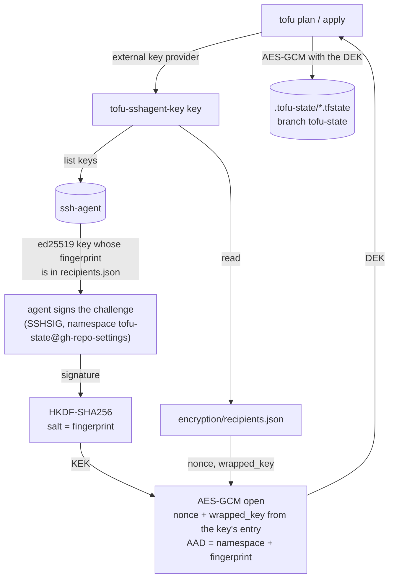

# gh-repo-settings

One set of repository settings for every non-fork repository of `abrosimov` and of the
`abrosimov-tech` organisation, plus the organisation's own settings, managed with OpenTofu.

## What the baseline enforces

Every repository gets the same policy from [`modules/repo-baseline`](modules/repo-baseline):

| Area | Setting |
|---|---|
| Merging | merge commit and squash allowed, rebase off; auto-merge on; head branch deleted after merge |
| Ruleset `baseline` on the default branch | no deletion, no force-push, signed commits required, pull request required with zero approvals, merge or squash only; the admin role bypasses it |
| CI gate | on repositories with the topic `ci-gated`, the check `required` from GitHub Actions must pass (not required to be up to date with the base) |
| Actions | on or off per owner or per repository (see below); all actions allowed; pinning to a full commit SHA enforced once every workflow is pinned (`enforce_sha_pinning` in the stack); `GITHUB_TOKEN` read-only by default and unable to approve pull requests |
| Security | Dependabot alerts on (Renovate reads them), Dependabot security pull requests off (Renovate raises them); secret scanning and push protection on public repositories |

The default branch is always `master`. Identity and presentation — name, description, topics,
visibility — are set only when OpenTofu creates a repository and never touched afterwards.

## Layout

- `modules/repo-baseline` — the per-repository policy.
- `stacks/abrosimov`, `stacks/abrosimov-tech` — one root per owner. Each lists every repository the
  owner has in `declared_repositories`, checks the list against GitHub on every plan, and adopts
  existing ones through `import` blocks; the organisation stack also manages organisation settings
  and its Actions policy.
- `repo-template` (a repository of `abrosimov`) — the template new repositories are generated from.
- `cmd/tofu-sshagent-key` — the key provider OpenTofu runs to encrypt and decrypt state.
- `encryption/recipients.json` — the state key wrapped once per enrolled SSH key. Public by design.
- `stacks/abrosimov/delivery.tf` — this repository's CI/CD environments and the state branch rule.
- branch `tofu-state` — the encrypted state files.

## Creating a repository

`declared_repositories` in the owner's stack is the list of every repository the owner has, forks
aside. Add an entry with a visibility and merge:

```hcl
"new-service" = {
  visibility  = "private"
  description = "What it is for"
  topics      = ["actions-enabled"] # optional
}
```

In `abrosimov` it is generated from `repo-template`: a pinned Renovate preset, CI with the
`required` check, `.gitignore` and the Apache-2.0 licence, in one commit GitHub signs. Set
`template = null` for an empty repository with an initial commit instead; `abrosimov-tech` has no
template yet. Later changes to the template never reach repositories already generated from it.

Visibility, description, topics and `is_template` are set at creation only; later edits happen on
GitHub, which is why an existing repository's entry is empty (`"cv" = {}`).

The list and GitHub must agree. A repository created by hand on GitHub stops every plan until it has
an entry — the plan names it — and the daily scheduled plan on `master` fails until then, which
GitHub reports by mail. Adding the entry adopts the repository on the next apply.

## Default branch

Every repository's default branch is `master`. A repository whose default branch has another name
gets it renamed on the next apply. An empty repository has no branch yet, so its first push decides:
push `master` first.

## How changes ship

CI does the work; a laptop plans freely and applies only in an emergency (see
[Running it locally](#running-it-locally)).

1. Open a pull request. The `plan` job plans both stacks with read-only tokens and puts each plan
   in the run's summary; a failed plan fails `required`.
2. Merge it. The `apply` job applies both stacks with write tokens and commits the state to the
   `tofu-state` branch.

Secrets live in two environments of this repository and are set with `gh secret set --env`:

| Secret | `plan` | `apply` |
|---|---|---|
| `CI_SSH_KEY` | the CI ed25519 private key, enrolled as a state-key recipient | same |
| `GH_TOKEN_ABROSIMOV` | fine-grained token for `abrosimov`, read-only | same owner, read and write |
| `GH_TOKEN_ABROSIMOV_TECH` | fine-grained token for `abrosimov-tech`, read-only | same owner, read and write |

`apply` is reachable from `master` only; `plan` runs for pull requests from this repository, never
from forks. The environments themselves are managed in `stacks/abrosimov/delivery.tf`; their secret
values never pass through OpenTofu.

## State

The state of each stack is a file on the `tofu-state` branch: `abrosimov.tfstate`,
`abrosimov-tech.tfstate`. The baseline ruleset protects only the default branch, so CI pushes the
branch with the workflow token; a separate ruleset forbids deleting or force-pushing it.

## Running it locally

Plan from a laptop freely: it only reads, and it sees what a read-only CI token cannot, such as the
merge settings. Apply through a pull request; a local apply is the emergency path, for when CI
cannot apply.

Requirements: [Task](https://taskfile.dev), OpenTofu 1.13 or newer, Go as pinned in `go.mod`, the
`gh` CLI logged in (the provider uses `gh auth token` when `GITHUB_TOKEN` is unset), and an enrolled
ed25519 key in `ssh-agent`. The organisation stack also reads the billing email and the Actions
policy, which need the `admin:org` scope: `gh auth refresh -h github.com -s admin:org`.

| Task | What it does |
|---|---|
| `task state:setup` | once: checks out the state branch as a worktree in `.tofu-state` |
| `task plan [OWNER=abrosimov-tech]` | pulls the state, then plans one stack (`abrosimov` by default) |
| `task apply [OWNER=abrosimov-tech]` | pulls the state, applies one stack after confirmation, pushes the state |
| `task state:pull`, `task state:push` | brings the state up to date; commits and pushes it after a state edit |
| `task check` | the checks CI runs: `tofu fmt -check`, `go vet`, `go test`, golangci-lint, `tofu validate` |
| `task fmt` | formats OpenTofu and Go sources |
| `task key:list`, `key:enroll`, `key:revoke FINGERPRINT=…`, `key:init` | state-key recipients, see [State encryption](#state-encryption) |

The state has no lock shared with CI, so `task apply` refuses to start unless:

- `HEAD` is `origin/master` and nothing under `stacks` or `modules` is uncommitted: the next CI
  apply would revert anything master does not have;
- no CI run on `master` is still going: two applies at once leave one state unpushed;
- `.tofu-state` has no uncommitted changes.

It pushes the state even when the apply fails part-way, because whatever it changed is recorded
there.

## Gating a repository on CI

1. Add an aggregator job to the repository's CI, named exactly `required`:

   ```yaml
   required:
     name: required
     if: always()
     needs: [lint, test] # every other job
     runs-on: ubuntu-26.04
     steps:
       - run: test "${{ contains(needs.*.result, 'failure') || contains(needs.*.result, 'cancelled') }}" = false
   ```

   A skipped job does not fail the gate, so a job skipped on purpose (`if:` on a release step)
   is fine. A job skipped because one it needs failed still fails the gate through that failure.

   The workflow must run on every pull request: a `paths:` filter leaves pull requests outside
   those paths without the check, and they never merge.

2. Once it is on the default branch, add the topic `ci-gated` to the repository and apply.

Adding the topic first blocks every merge, because the required check never reports.

## Switching GitHub Actions on or off

- **Every repository of an owner:** set `actions_enabled` in `stacks/<owner>/repositories.tf` and
  apply.
- **One repository:** add the topic `actions-disabled` or `actions-enabled` to it and apply. The
  topic wins over the stack-wide switch; with both topics present, Actions is off.

A `ci-gated` repository cannot have Actions off: the plan stops, because the required check would
never report and every merge would block.

`gh-repo-settings` keeps Actions on whatever the switch and its topics say: its own CI applies this
configuration, so with Actions off there only a local apply could turn them back on.

## State encryption

The state and plan files sit on a branch of a public repository, and they hold everything OpenTofu
knows about the repositories. So they are never written in the clear: OpenTofu encrypts them with
AES-GCM, and the key comes from `cmd/tofu-sshagent-key`, which OpenTofu runs as an external key
provider. The goal is that whoever has an enrolled SSH key in `ssh-agent` (a laptop, CI) can read
and write the state, nobody else can, and no symmetric secret has to be stored or passed around.

### Two keys

- **DEK, the data key** — a random 32-byte AES key that encrypts the state and plan files. There is
  one for the whole repository, and it is never stored in the clear anywhere.
- **KEK, a key-encryption key** — one per enrolled SSH key. It encrypts ("wraps") a copy of the DEK.
  It is not stored either: it is derived anew on every run from a signature that `ssh-agent` makes.

The DEK is wrapped once per enrolled key, and the wrapped copies are kept in
`encryption/recipients.json`. Any one enrolled key unwraps its copy and gets the same DEK.
Two levels keep the keys independent: adding or removing a laptop rewraps one copy of the DEK and
leaves the state as it is, and every key sees the same state.

### Deriving the KEK

1. The agent signs a fixed challenge in the SSHSIG format, under the namespace
   `tofu-state@gh-repo-settings`; that is what `ssh-keygen -Y sign -n tofu-state@gh-repo-settings`
   would sign. The namespace keeps this signature apart from SSH logins and git commit signatures,
   and the reverse: no signature made for another purpose yields the KEK.
2. The signature is checked against the key, then fed to HKDF-SHA256 with the key's fingerprint as
   the salt, which gives a 32-byte KEK.

An ed25519 signature is deterministic, so the same key and the same challenge give the same KEK every
time. That is why only ed25519 keys are accepted: ECDSA signatures are randomised, so their KEK
would change from run to run.

The signature only has to stay secret as long as the state does. Whoever can make your agent sign
this challenge — through agent forwarding to a host you do not trust, say — can derive your KEK.

### What a run does



The key provider tries the enrolled keys in the agent's order and stops at the first that unwraps
its copy. The DEK goes to OpenTofu on stdout and is never written to disk.

### `encryption/recipients.json`

```json
{
  "recipients": [
    {
      "fingerprint": "SHA256:AnxjIWWcb2OQreVuBksQcA2AxImy6VXXia6CvnzfgOE",
      "comment": "gh-repo-settings-ci",
      "nonce": "M+MbwONYRkU1Bd2o",
      "wrapped_key": "pbWh86E4d02mCdHWKn11LIJK2FFv3WFuP7VAh3XL10H6DNea01Gt+SM1UQgTkier"
    }
  ],
  "version": 1
}
```

| Field | Meaning |
|---|---|
| `version` | Format version. A file with any other version is refused. |
| `fingerprint` | SHA-256 fingerprint of the enrolled key, as `ssh-add -l -E sha256` prints it. It is how a key in the agent finds its entry, the HKDF salt, and part of the AAD, so a `wrapped_key` moved to another entry fails to open. |
| `comment` | The key's comment in the agent when it was enrolled. For people only: `list` and `revoke` show it; it plays no part in the cryptography and can be edited by hand. |
| `nonce` | The 12-byte AES-GCM nonce used to wrap this copy, base64. |
| `wrapped_key` | The DEK encrypted under this key's KEK: 32 bytes of ciphertext and a 16-byte GCM tag, base64. |

Entries are sorted by fingerprint. The public keys themselves are not stored: the agent supplies the
key, and the fingerprint is enough to find its entry.

The file is public by design. A `wrapped_key` opens only with a signature from its private key, and
enrolling a new key needs the DEK, so it needs a key that is enrolled already. CI and every laptop
read the file from the checkout, so it lives in the repository rather than on one machine; without it
the DEK is gone.

### Managing keys

```sh
task key:list
task key:enroll
task key:revoke FINGERPRINT=SHA256:…
```

`list` shows the enrolled keys and which are in the agent now; `enroll` wraps the key for every new
ed25519 key in the agent. To enrol a new laptop, have an already enrolled key and the new key in the
agent at the same time, run `task key:enroll` and commit `encryption/recipients.json`.

`enroll` records the comment the agent reports, usually `user@hostname`, in a public file. Give the
key a neutral comment first (`ssh-keygen -c -C mac-m1-pro-max-home -f ~/.ssh/id_ed25519`, then add it
to the agent again), or edit `comment` in the file before committing.

The CI key (`gh-repo-settings-ci`) was enrolled the same way: added to the agent for one `enroll`,
then removed. To replace it, generate a new key, enrol it, store it in `CI_SSH_KEY` in both
environments, and revoke the old fingerprint.

Revoking a key removes its wrapping but not its knowledge of the data key, and the git history
keeps every earlier state. If a key is compromised, rotate the data key: move the current
configuration into a `fallback` block, initialise a new recipients file, apply, and commit.

If every key is lost, delete the state files and apply: the `import` blocks adopt every repository
again, so nothing is lost but the history.

## When a repository leaves the set

Archiving, transferring or deleting a repository removes it from discovery while its entry is still
in `declared_repositories`, and the plan stops: an entry with no visibility cannot be created, and
one with a visibility would be created again. Open a pull request that drops the entry; dropping it
alone stops the plan at `prevent_destroy`, so before merging, forget the repository from the state
(a `removed` block cannot name a single `for_each` instance):

```sh
tofu -chdir=stacks/abrosimov state rm 'module.repo["<name>"]'
```

Then push the updated state with `task state:push` and merge.
